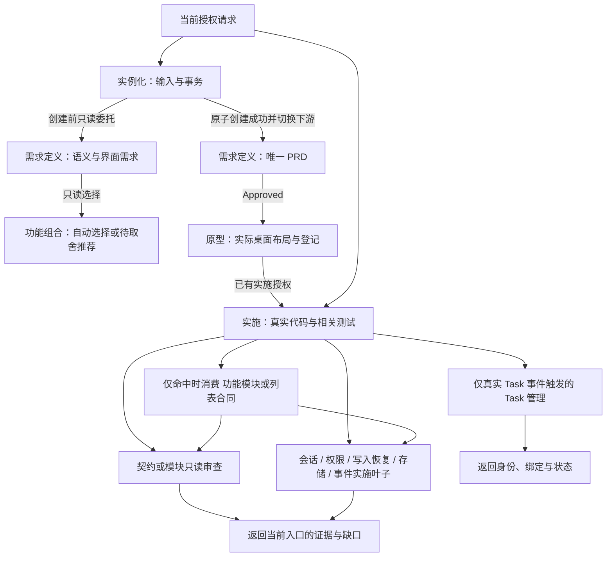

# Skill 职责与组合

本专题解释当前源 Harness 的能力拆分及调用关系。执行规则以 [工程规则](../ENGINEERING_RULES.md#72-skill-职责复用与渐进披露) 为准；本地图不启动产品流程，不保存另一份业务规格。

## 发现、执行、参考三层

1. 发现层使用目录名、frontmatter 与 `agents/openai.yaml`，只说明独立触发、职责和结果，避免把“包含某关键词”当成自动调用条件。
2. 执行层完整读取当前命中的 `SKILL.md`，确认范围和写入边界。阶段入口保留编排，叶子只做一项可复用工作，完成后返回当前入口。
3. 参考层按阶段、宿主和实际能力读取规范章节、参考文件或资产。需求任务不为完整性读全部实施/设计资料，SSE 不连带读取 RxJS，列表不启用列偏好就不适配迁移资产。

调用方传入范围、阶段、事实来源与仍有效的验证证据。每个事实只有一个拥有者，不因调用新的 Skill 再创建 PRD、索取全套 API、复读无关策略或运行完整验收。

## 全部能力地图

以下 32 个 `web-*` Skill 及只读并发与性能审查为源能力（Workspace/Go 领域 Skills 见 [Workspace 规范](../WORKSPACE_TEMPLATE.md)）；实际下游只分发当前宿主适用部分。表中名称均对应 `.agents/skills/<名称>/SKILL.md`。

| 职责组     | 独立入口                                                                                       | 结果与保留边界                                                       |
| ---------- | ---------------------------------------------------------------------------------------------- | -------------------------------------------------------------------- |
| 创建与环境 | `web-instantiate-project`、`web-check-development-environment`、`web-prepare-brand-identity`   | 新下游、环境诊断、品牌资产分别交付；检查不自动安装，品牌不重新初始化 |
| 产品与设计 | `web-define-product`、`web-design-prototype`                                                   | 需求语义/唯一 PRD 与实际桌面原型分别拥有；创建前分析只读返回         |
| 实施与重构 | `web-implement-change`、`web-refactor-code`                                                    | 授权行为变化与行为保持重构分别验证；按事件调用叶子                   |
| 模块审查   | [`web-review-module-boundaries`](../../.agents/skills/web-review-module-boundaries/SKILL.md)   | 只读职责、依赖和状态拥有者地图；不自动重构                           |
| 并发与性能 | [`workspace-review-performance`](../../.agents/skills/workspace-review-performance/SKILL.md)   | 只读死锁、无界等待、泄漏与热点证据；无基准不下性能结论，实施归调用方 |
| 接口契约   | [`web-review-api-contract`](../../.agents/skills/web-review-api-contract/SKILL.md)             | 只读当前操作的来源/实现关联与差异；不联网、不写模块文档              |
| 服务与文档 | `web-connect-http-service`、`web-document-api`                                                 | 已授权真实接入与合同/实现文档分别负责；设计与 Mock 不冒充已联调      |
| 身份会话   | [`web-implement-auth-session`](../../.agents/skills/web-implement-auth-session/SKILL.md)       | 唯一会话状态机、异步归属和退出失效接线；不拥有页面设计或持久化授权   |
| 访问控制   | [`web-implement-access-control`](../../.agents/skills/web-implement-access-control/SKILL.md)   | 菜单、路由和动作的一致判断与撤权；消费既有身份、作用域与权限         |
| 写入恢复   | [`web-implement-write-recovery`](../../.agents/skills/web-implement-write-recovery/SKILL.md)   | 当前操作的防重复、未知查询、冲突和成功后刷新；允许状态仍归领域       |
| 本地存储   | [`web-implement-browser-storage`](../../.agents/skills/web-implement-browser-storage/SKILL.md) | 真实存储访问、校验、迁移与失败语义；凭据例外和列表 key 仍归领域      |
| 持续事件   | [`web-implement-event-stream`](../../.agents/skills/web-implement-event-stream/SKILL.md)       | 实际协议的连接、恢复与投影；不默认采用 RxJS 或持续后台               |
| UI 专项    | `web-implement-list-view`、`web-extract-i18n-strings`                                          | Web 列表行为与既有语言资源迁移各自内聚，不按控件/语言碎片化          |
| 功能组合   | `web-compose-capabilities`                                                                     | 拥有独立模块与操作判据，按阶段只读返回知识、设计参考和模板           |
| 宿主审查   | `web-review-extension-compatibility`                                                           | 只读受影响消费者的双目标证据；修复与真实候选仍归调用方               |
| 用户 Task  | [`web-manage-user-tasks`](../../.agents/skills/web-manage-user-tasks/SKILL.md)                 | 左侧 Task 编号、身份绑定和真实进度；不代做业务或开启长期开关         |
| 计划与 Git | `web-plan-change`、`web-configure-git-commits`                                                 | 独立事件触发的持久计划与实际提交配置，不成为日常必经步骤             |
| 内部工作树 | `web-audit-worktrees`、`web-run-parallel-worktrees`                                            | 既有证据审计与已获准内部并行分别负责；不代替左侧 Task                |
| 候选与验收 | `web-prepare-release`、`web-verify-delivery`、`web-test-final-artifact-e2e`                    | 候选准备、准入/结论、已批准场景证据分别拥有；日常开发不自动调用      |
| 升级       | `web-preview-harness-upgrade`、`web-upgrade-harness`                                           | 只读冻结比较与批准后的应用分别负责，先补齐叶子再更新父入口           |
| 历史与记忆 | `web-summarize-development-history`、`web-curate-harness-memory`                               | 只读追溯与源历史整理分别负责，不因回顾自动改写记录                   |

## 创建需求与能力的归属

保留现有 Skill，不为文档读取、登录页面或某个模块再建编排壳。各职责只拥有自己的判据与产物：

| 能力                                                   | 唯一拥有者                                                                           | 输入与输出边界                                                                     |
| ------------------------------------------------------ | ------------------------------------------------------------------------------------ | ---------------------------------------------------------------------------------- |
| 宿主、固定工程输入、需求来源及原文事务交接             | [`web-instantiate-project`](../../.agents/skills/web-instantiate-project/SKILL.md)   | 收集与冻结原文、委托分析、确认工程输入与事务交接；不判断产品功能                   |
| 文档语义、基础页面/工作区需求与唯一 PRD                | [`web-define-product`](../../.agents/skills/web-define-product/SKILL.md)             | 创建前只读分析需求，唯一适配自动选择，等价或争议才推荐；成功下游确认并记录唯一范围 |
| 身份、权限、组织、商品、订单、钱包支付、审计的具体操作 | [`web-compose-capabilities`](../../.agents/skills/web-compose-capabilities/SKILL.md) | 根据已分析流程返回独立能力与资源；不拥有完整文档分析或业务装配                     |
| 实际桌面布局、交互原型、自查和摘要登记                 | [`web-design-prototype`](../../.agents/skills/web-design-prototype/SKILL.md)         | 只消费 Approved PRD；需求变化返回需求定义，不重新决定产品范围                      |
| 真实页面、业务代码与模板装配及相关验证                 | [`web-implement-change`](../../.agents/skills/web-implement-change/SKILL.md)         | 按授权范围适配模板并实施，真实领域事件委托相应叶子                                 |

PRD 结构归需求定义的 `references/prd-outline.md`；需求分析合同归其 `references/requirements-analysis.md`；模块判据归功能组合的 `references/requirements-selection.md`；输入与创建 SOP 归实例化的 `references/requirements-intake.md`。原型目录不保留第二份 PRD 合同。

## 调用方向与事实归属

图中的实线是调用方向；被委托的只读分析和选择完成后返回当前调用方，不回调实例化或独立启动下游开发。Agent 完整创建汇总的一次确认覆盖已列明的首版范围及下游 PRD、原型、实施和开发走查；成功下游复用确认并登记唯一 PRD，不重复索要同一范围的批准。CLI 工程事务确认只控制工程与原文交接，其成功不代表首版完成。可选需求文档缺省时，按固定表单及当前需求补齐范围；不因未提供文档跳过范围澄清或自动启用功能。

需求或原型阶段只读领域合同，不调用实施叶子修改代码。身份、组织、权限、订单、资金和审计不变量归功能组合中的独立知识，真实实现由实施入口按当前契约组织；访问控制消费既有身份与权限，存储、写入恢复和 HTTP 叶子各自处理已触发边界，不成为另一套业务流程。数据访问、工程与策略文档继续拥有规范正文。

## 继续保持内聚的部分

- 身份会话实施由 `web-implement-auth-session` 统一拥有状态机和异步提交权；领域不变量仍归身份知识。登录、注册、找回与退出共享身份模块知识和会话模板，按实际操作选择；不恢复已删除的产品模式 Skill。低层会话 helper 保持独立；完整用户方案仍须恢复[账号、组织与成员上下文](../../.agents/skills/web-compose-capabilities/knowledge/identity.md#完整用户信息)，由唯一会话 owner 协调，不因模块分离缩减用户信息。
- REST、GraphQL 与已实现业务说明由同一 API 文档 Skill 按真实业务聚合并核对漂移，不建立与接口或业务拥有者竞争的记录。
- 初始化与环境、Worktree 审计与执行、升级预演与应用、候选与验收已有独立结果，不再按每个命令拆转发壳。
- 渐进式提问和默认建议是通用工程约定，保留在工程规则，不新增每次必读的交互 Skill。

## 分发与升级

新增叶子同时进入源发现合同、终端目录/关键正文门禁、三份独立升级所有权及精确文件传播清单。现有下游升级须先补齐叶子与元数据再委托或更新父入口，不能因目录数量正确就忽略内容陈旧。
